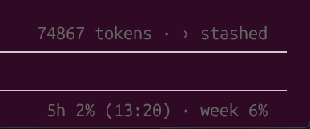

# claude-inline-usage-meter

A [Claude Code](https://claude.com/claude-code) mod that shows your plan usage right in the prompt footer, bottom right, next to the session modes:



- **5h**: current 5-hour window usage, with its reset time (local) in parentheses
- **week**: weekly window usage

It refreshes after every turn and whenever a window moves by one point. It shows nothing when you're not on a subscription plan, or before the first response of the session.

## Install

At the prompt of a terminal session:

```
/plugin install usage-meter --marketplace xLinkOut/claude-inline-usage-meter
```

From a shell:

```
claude plugin install usage-meter --marketplace xLinkOut/claude-inline-usage-meter
```

Answer `y` to add the marketplace, then pick a scope (user scope loads it in every session).

In the desktop app: click **+** next to the prompt box → **Plugins** → **Add marketplace** with `xLinkOut/claude-inline-usage-meter` → **Add plugin**.
